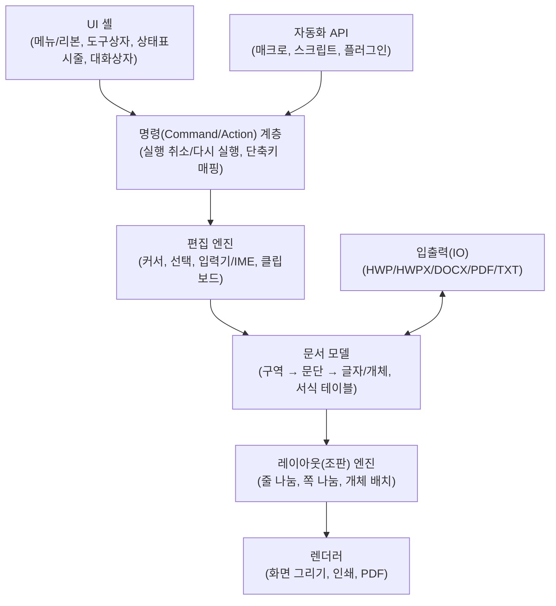

# 한글(HWP) · Word 앱 구조 분석

> ClassingHWP(한글 워드프로세서) 개발을 위한 사전 조사 문서
> 대상: 한컴오피스 **한글**(HWP 5.0 / HWPX), Microsoft **Word**(DOCX / DOC)

---

## 목차

1. [개요: 워드프로세서의 공통 계층 구조](#1-개요-워드프로세서의-공통-계층-구조)
2. [UI(사용자 인터페이스) 구조](#2-ui사용자-인터페이스-구조)
3. [문서 모델(논리 구조)](#3-문서-모델논리-구조)
4. [서식 시스템(글자·문단·스타일)](#4-서식-시스템글자문단스타일)
5. [개체(Object) 시스템](#5-개체object-시스템)
6. [파일 포맷 구조](#6-파일-포맷-구조)
7. [레이아웃(조판) 엔진](#7-레이아웃조판-엔진)
8. [입력·편집 엔진](#8-입력편집-엔진)
9. [자동화·확장 API](#9-자동화확장-api)
10. [기능 목록 비교](#10-기능-목록-비교)
11. [단위 체계](#11-단위-체계)
12. [ClassingHWP 설계에 주는 시사점](#12-classinghwp-설계에-주는-시사점)
13. [참고 자료](#13-참고-자료)

---

## 1. 개요: 워드프로세서의 공통 계층 구조

한글과 Word는 겉모습은 다르지만 내부는 거의 같은 계층으로 나뉩니다.



| 계층 | 한글 | Word |
|---|---|---|
| UI | 메뉴 탭 + 기본/서식 도구 상자, 작업 창 | 리본(Ribbon) + 빠른 실행 도구 모음, 탐색 창 |
| 명령 | **Action** (`Run("CharShape")` 등) | **Command** (VBA `WordBasic`, 리본 `idMso`) |
| 문서 모델 | 구역(Section) → 문단 → 글자/컨트롤 | Story → 단락(Paragraph) → Run |
| 서식 | ID 참조 방식(글자 모양/문단 모양 테이블) | 스타일 상속 + 직접 서식(속성 오버라이드) |
| 파일 | HWP(바이너리 CFB) / **HWPX(XML ZIP)** | DOC(바이너리 CFB) / **DOCX(XML ZIP)** |

---

## 2. UI(사용자 인터페이스) 구조

### 2.1 한글 UI

```
┌──────────────────────────────────────────────────────────────┐
│ 제목 표시줄 (문서명 - 한글)                                    │
├──────────────────────────────────────────────────────────────┤
│ 메뉴 탭: 파일 편집 보기 입력 서식 쪽 보안 검토 도구            │
├──────────────────────────────────────────────────────────────┤
│ 기본 도구 상자 (선택한 메뉴 탭의 큰 아이콘 그룹 = 리본 유사)    │
├──────────────────────────────────────────────────────────────┤
│ 서식 도구 상자 (스타일, 글꼴, 크기, 굵게/기울임, 정렬, 줄간격)  │
├───────┬──────────────────────────────────────────┬───────────┤
│ 가로/세로 눈금자                                  │  작업 창   │
│       │                                          │ (스타일,  │
│       │          편집 화면 (쪽 윤곽 보기)          │  개요,    │
│       │                                          │  클립아트) │
├───────┴──────────────────────────────────────────┴───────────┤
│ 문서 탭 (여러 문서를 탭으로 전환)                              │
├──────────────────────────────────────────────────────────────┤
│ 상태 표시줄: 1/3쪽 1단 5줄 12칸 | 구역 1/1 | 삽입/수정 | 배율  │
└──────────────────────────────────────────────────────────────┘
```

**특징**
- **메뉴 + 도구 상자 이중 구조**: 전통적인 풀다운 메뉴(메뉴 탭 옆 ▼)와 리본형 도구 상자를 동시에 제공
- **상황별 탭**: 표/그림/수식 선택 시 `표 레이아웃`, `그림` 같은 전용 탭이 자동으로 나타남
- **상태 표시줄 정보가 매우 상세**: 쪽/단/줄/칸, 구역, 삽입·수정 모드 → 조판 위치를 사용자가 정확히 인지
- **조판 부호 보기**(`보기 > 조판 부호`): 문서 안의 숨은 컨트롤(구역 정의, 단 정의, 표, 각주 등)을 `[구역 나누기]` 같은 부호로 표시
- **쪽 윤곽 보기**: 기본값이 인쇄 모양 그대로 보기(WYSIWYG)
- **대화상자 중심 서식**: `글자 모양(Alt+L)`, `문단 모양(Alt+T)`, `편집 용지(F7)` 대화상자에 대부분의 속성이 모여 있음

**대표 단축키 (한글 고유 체계)**

| 기능 | 한글 | Word |
|---|---|---|
| 저장 | `Alt+S` (또는 Ctrl+S) | `Ctrl+S` |
| 불러오기 | `Alt+O` | `Ctrl+O` |
| 글자 모양 | `Alt+L` | `Ctrl+D` |
| 문단 모양 | `Alt+T` | (단락 대화상자, 단축키 없음) |
| 편집 용지 | `F7` | (레이아웃 > 페이지 설정) |
| 스타일 | `F6` | `Ctrl+Alt+Shift+S` |
| 표 만들기 | `Ctrl+N, T` | (삽입 > 표) |
| 수식 | `Ctrl+N, M` | `Alt+=` |
| 한자 변환 | `F9` / `한자` 키 | `한자` 키 |
| 쪽 나누기 | `Ctrl+Enter` | `Ctrl+Enter` |
| 셀 블록 | `F5` (표 안에서) | - |
| 셀 합치기/나누기 | 셀 블록 후 `M` / `S` | - |

> 한글 사용자는 `Alt+L`, `Alt+T`, `F5`, `Ctrl+N,T` 같은 단축키에 매우 익숙하므로 **ClassingHWP에서 한글식 단축키 프리셋 제공**이 중요합니다.

### 2.2 Word UI

```
┌──────────────────────────────────────────────────────────────┐
│ 빠른 실행 도구 모음 | 제목 | 검색 | 계정 | 창 버튼            │
├──────────────────────────────────────────────────────────────┤
│ 리본 탭: 파일 홈 삽입 그리기 디자인 레이아웃 참조 편지 검토 보기 │
├──────────────────────────────────────────────────────────────┤
│ 리본 그룹: [클립보드][글꼴][단락][스타일 갤러리][편집]         │
├──────────┬───────────────────────────────────────────────────┤
│ 탐색 창   │            편집 화면 (인쇄 모양)                   │
│ (제목,    │                                                   │
│  페이지,  │                                                   │
│  결과)    │                                                   │
├──────────┴───────────────────────────────────────────────────┤
│ 상태 표시줄: 페이지 1/3 | 단어 수 | 언어 | 보기 전환 | 확대/축소│
└──────────────────────────────────────────────────────────────┘
```

**특징**
- **리본 + 백스테이지**: `파일` 탭은 전체 화면 백스테이지(새로 만들기/열기/정보/인쇄/공유)
- **스타일 갤러리 중심**: 서식을 직접 지정하기보다 스타일을 고르는 흐름을 유도
- **보기 모드 5종**: 읽기 모드, 인쇄 모양, 웹 모양, 개요, 초안
- **미니 도구 모음 / 상황별 탭**: 텍스트 선택 시 떠 있는 서식 도구, 표 선택 시 `테이블 디자인`, `레이아웃` 탭
- **서식 표시(¶)**: 한글의 조판 부호에 대응 (문단 기호, 공백, 탭, 숨은 텍스트)
- **클라우드·협업 UI**: 공유, 공동 편집자 커서, 메모 스레드, Copilot

### 2.3 UI 구조 비교 요약

| 항목 | 한글 | Word |
|---|---|---|
| 명령 진입점 | 메뉴 + 도구 상자 + 대화상자 | 리본 + 갤러리 + 작업창 |
| 서식 철학 | **모양(Shape) 직접 지정** 선호 | **스타일** 적용 선호 |
| 숨은 구조 표시 | 조판 부호 | 서식 표시(¶), 필드 코드 |
| 다중 문서 | 문서 탭 | 창 단위 |
| 상태 표시 | 쪽/단/줄/칸/구역 | 페이지/단어 수 |

---

## 3. 문서 모델(논리 구조)

### 3.1 한글 문서 모델

한글 문서는 **"문단 리스트"를 기본 단위**로 하는 트리 구조입니다. 표 셀, 머리말, 각주, 글상자 모두 내부에 **또 다른 문단 리스트**를 가집니다.

```
문서(Document)
├── 문서 정보(DocInfo) ─ 전역 테이블(ID 풀)
│   ├── 글꼴(FaceName) × 7개 언어별
│   ├── 테두리/배경(BorderFill)
│   ├── 글자 모양(CharShape)
│   ├── 문단 모양(ParaShape)
│   ├── 탭 정의(TabDef), 문단 번호(Numbering), 글머리표(Bullet)
│   ├── 스타일(Style)
│   └── 바이너리 데이터 목록(BinData: 그림 등)
│
└── 본문(BodyText)
    └── 구역(Section) 0..N
        └── 문단(Paragraph)
            ├── 문단 헤더: 문단모양 ID, 스타일 ID, 글자 수
            ├── 텍스트: UTF-16 문자열 + 제어 문자(컨트롤 자리)
            ├── 글자 모양 구간: [(위치, 글자모양 ID), ...]
            ├── 줄 정보(LineSeg): 조판 결과 캐시
            └── 컨트롤(Control) 0..N
                ├── 구역 정의(secd) → 용지 설정, 각주 모양, 쪽 테두리
                ├── 단 정의(cold)
                ├── 표(tbl ) → 셀 → 문단 리스트 → 문단...
                ├── 그리기 개체(gso ) → 그림/도형/글상자(문단 리스트)
                ├── 수식(eqed)
                ├── 머리말(head)/꼬리말(foot) → 문단 리스트
                ├── 각주(fn  )/미주(en  ) → 문단 리스트
                ├── 자동 번호(atno), 쪽 번호 위치(pgnp)
                ├── 필드(%hlk 하이퍼링크, %clk 누름틀 등)
                └── 책갈피, 숨은 설명, 덧말, 글자 겹침 ...
```

**핵심 포인트**
- **구역(Section)이 최상위 단위**: 용지 크기/방향/여백은 구역마다 다를 수 있음. 구역 설정은 구역 첫 문단 안의 `secd` 컨트롤로 저장됨
- **컨트롤은 텍스트 안에 "자리"를 차지**: 문단 텍스트 스트림에 제어 문자(0~31)가 박혀 있고, 이 위치가 곧 컨트롤(표, 그림 등)의 앵커 위치
- **서식은 ID 참조**: 문단은 서식 값을 직접 갖지 않고 `DocInfo`의 글자 모양/문단 모양 **ID만 참조**. 같은 서식은 하나의 ID를 공유(Flyweight 패턴)
- **스타일은 "글자 모양 ID + 문단 모양 ID"의 묶음**: 스타일 적용 = 두 ID를 바꾸는 것

### 3.2 Word 문서 모델

Word는 **Story(이야기 흐름)** 단위로 나뉘며, 각 Story가 블록(단락/표)의 시퀀스입니다.

```
문서(Document)
├── 스타일(styles.xml): docDefaults + 단락/문자/표/번호 스타일
├── 번호 매기기(numbering.xml): abstractNum → num
├── 설정(settings.xml), 글꼴 표(fontTable.xml), 테마(theme1.xml)
│
├── 본문 Story (document.xml → w:body)
│   ├── 단락(w:p)
│   │   ├── 단락 속성(w:pPr): 스타일, 정렬, 들여쓰기, 간격, 번호
│   │   └── 인라인 콘텐츠
│   │       ├── Run(w:r): 문자 속성(w:rPr) + 텍스트(w:t) / 탭 / 줄바꿈
│   │       ├── 하이퍼링크(w:hyperlink) → Run...
│   │       ├── 필드(w:fldSimple, w:fldChar begin/separate/end)
│   │       ├── 그림(w:drawing → DrawingML: 인라인/앵커)
│   │       ├── 책갈피(w:bookmarkStart/End), 메모 범위
│   │       └── 변경 내용(w:ins, w:del)
│   ├── 표(w:tbl) → 행(w:tr) → 셀(w:tc) → 단락/표 ...
│   ├── 콘텐츠 컨트롤(w:sdt)
│   └── 구역 속성(w:sectPr): 마지막 단락 또는 body 끝에 위치
│
├── 머리글/바닥글 Story (header1.xml, footer1.xml ...)
├── 각주/미주 Story (footnotes.xml, endnotes.xml)
├── 메모 Story (comments.xml)
└── 글상자 Story (w:txbxContent)
```

**핵심 포인트**
- **Run 기반 인라인 모델**: 같은 문자 서식을 가진 연속 텍스트 = 하나의 Run. 서식이 바뀌면 Run이 쪼개짐
- **구역 속성이 "끝"에 붙음**: `w:sectPr`는 해당 구역의 **마지막 단락** `w:pPr` 안에 위치 (한글은 구역 **처음**에 위치 → 정반대)
- **서식은 값을 직접 보유**: 각 Run/단락이 속성 값을 직접 가지고, 스타일을 상속한 뒤 덮어씀
- **필드(Field) 시스템**: 쪽 번호, 목차, 상호 참조, 날짜 등이 모두 필드 코드(`PAGE`, `TOC \o "1-3"`)로 표현

### 3.3 문서 모델 비교

| 개념 | 한글 | Word |
|---|---|---|
| 최상위 분할 | 구역(Section), 시작에 정의 | 구역(Section), 끝에 정의 |
| 블록 | 문단 (표도 문단 안의 컨트롤) | 단락 **또는** 표 (표가 블록 레벨) |
| 인라인 | 텍스트 + 글자모양 구간 + 컨트롤 | Run 시퀀스 |
| 서식 저장 | **ID 참조** (전역 테이블) | **속성 값 직접 기록** + 스타일 상속 |
| 표 위치 | 문단 안의 컨트롤 (글자처럼 취급 가능) | 본문 블록 레벨 요소 |
| 머리말/각주 | 본문 안의 컨트롤 → 내부 문단 리스트 | 별도 Story(별도 파일) |
| 레이아웃 캐시 | **파일에 줄 정보(LineSeg) 저장** | 저장 안 함(열 때 재조판) |

> ⚠️ **중요한 차이: 표의 위치**
> 한글에서 표는 항상 **어떤 문단 안에 앵커된 개체**입니다(`글자처럼 취급` 옵션으로 인라인 배치 가능).
> Word에서 표는 **단락과 동등한 블록**입니다. HWP↔DOCX 변환 시 가장 까다로운 부분 중 하나입니다.

---

## 4. 서식 시스템(글자·문단·스타일)

### 4.1 글자 모양 (한글 CharShape / Word rPr)

| 속성 | 한글 | Word |
|---|---|---|
| 글꼴 | **7개 언어별 글꼴**: 한글, 영문, 한자, 일어, 외국어, 기호, 사용자 | 4개 슬롯: `ascii`, `hAnsi`, `eastAsia`, `cs`(복합 스크립트) |
| 크기 | 기준 크기 + **언어별 상대 크기(%)** | 크기(`w:sz`, 반 포인트 단위) |
| 장평 | **언어별 장평(%)** (글자 가로 비율, 50~200%) | 문자 배율(`w:w`) |
| 자간 | **언어별 자간(%)** (-50~50%) | 문자 간격(`w:spacing`, twip) |
| 글자 위치 | 언어별 세로 위치(%) | 위치 올림/내림(`w:position`) |
| 장식 | 진하게, 기울임, 밑줄(종류/색/위치), 취소선, 외곽선, 그림자, 양각, 음각, 위/아래 첨자, 강조점 | 굵게, 기울임, 밑줄, 취소선, 윤곽, 그림자, 양각, 음각, 첨자, 강조점(`w:em`) |
| 색 | 글자 색, 음영 색 | 글자 색, 강조(하이라이트), 음영 |
| 기타 | 커닝, 테두리/배경(BorderFill ID) | 커닝, 테두리, 숨김, 작은 대문자 등 |

> **한글 고유**: 장평·자간·상대 크기를 **언어별로** 따로 지정할 수 있음. 한국 공문서/보고서에서 장평 95%, 자간 -5% 같은 설정이 매우 흔함 → ClassingHWP은 반드시 지원해야 함.

### 4.2 문단 모양 (한글 ParaShape / Word pPr)

| 속성 | 한글 | Word |
|---|---|---|
| 정렬 | 양쪽, 왼쪽, 오른쪽, 가운데, 배분, 나눔 | 양쪽, 왼쪽, 오른쪽, 가운데, 균등 분할 |
| 여백 | 왼쪽/오른쪽 여백, 첫 줄 들여쓰기/내어쓰기 | 왼쪽/오른쪽 들여쓰기, 첫 줄/내어쓰기 |
| 줄 간격 | **글자에 따라(%)** (기본 160%), 고정 값, 여백만 지정, 최소 | 배수, 고정, 최소 |
| 문단 간격 | 문단 위/아래 | 단락 앞/뒤 |
| 줄 나눔 기준 | **한글: 어절/글자**, **영어: 단어/하이픈/글자** | 한국어 줄 바꿈 옵션(어절 단위) |
| 쪽 나눔 제어 | 외톨이줄 보호, 다음 문단과 함께, 문단 보호, 문단 앞에서 항상 쪽 나눔 | 페이지 매김 제어, 다음 단락과 함께, 단락 나누지 않음, 앞에서 페이지 나누기 |
| 번호/글머리표 | 개요 번호, 문단 번호, 글머리표 (7~10수준) | 다단계 목록(numbering.xml, 9수준) |
| 기타 | 탭 정의 ID, 테두리/배경 ID, 격자 사용, 최소 공백 | 탭, 테두리, 음영, 문자 그리드 |

### 4.3 스타일 시스템

**한글**
- 스타일 = 이름 + **문단 모양 ID + 글자 모양 ID** + 다음 스타일 ID
- 종류: 문단 스타일, 글자 스타일
- 기본 스타일: `바탕글`, `본문`, `개요 1~10`, `쪽 번호`, `머리말`, `각주`, `미주`, `메모`, `차례 제목`, `차례 1~3`, `캡션`
- 스타일을 바꿔도 **직접 지정한 모양이 우선**하지만, 모델상으로는 문단이 가진 ID 자체가 최종 서식

**Word — 서식 상속 체인 (아래로 갈수록 우선)**

```
docDefaults (문서 기본값: rPrDefault / pPrDefault)
  └─ 표 스타일 (표 안일 때)
      └─ 번호 매기기 수준 속성
          └─ 단락 스타일 (basedOn 체인으로 상속)
              └─ 문자 스타일 (basedOn 체인)
                  └─ 직접 서식 (w:pPr / w:rPr)
```

- 스타일 종류: 단락(paragraph), 문자(character), 연결(linked), 표(table), 번호(numbering)
- `basedOn`으로 스타일 간 상속, `next`로 다음 단락 스타일 지정
- 테마 글꼴/테마 색(`+본문`, `+제목`)을 참조 가능

**비교**

| | 한글 | Word |
|---|---|---|
| 서식 결정 방식 | 최종 ID 참조 (평탄화된 값) | **속성 상속 계산(Cascade)** |
| 스타일 상속 | 없음 (스타일 간 basedOn 없음) | `basedOn` 체인 |
| 장점 | 조판 시 계산이 단순, 결정적 | 스타일 일괄 변경이 강력 |
| 단점 | 스타일 일괄 수정 반영이 제한적 | 최종 서식 계산 비용 큼, 예측 어려움 |

---

## 5. 개체(Object) 시스템

### 5.1 개체 종류

| 개체 | 한글 | Word |
|---|---|---|
| 표 | 표 (셀 합치기/나누기, 계산식, 셀 블록 연산) | 표 (셀 병합, 수식 필드) |
| 그림 | 그림 (자르기, 효과, 워터마크) | 그림 (DrawingML) |
| 도형 | 그리기 개체 (선, 사각형, 타원, 호, 다각형, 곡선, 묶음) | 도형 (DrawingML/VML) |
| 글상자 | 글상자 (도형 내부 문단 리스트) | 텍스트 상자 |
| 수식 | **한글 수식 편집기** (스크립트 기반: `{a} over {b}`) | OMML(Office Math), LaTeX 입력 지원 |
| 차트 | 차트 | 차트 (DrawingML Chart) |
| 글맵시 | 글맵시 (텍스트 아트) | WordArt |
| 양식 | 양식 개체 (체크박스, 콤보, 입력란), **누름틀** | 콘텐츠 컨트롤(`w:sdt`), 레거시 양식 필드 |
| OLE | OLE 개체 | OLE 개체 |
| 비디오 | 동영상 | 온라인 비디오 |

### 5.2 개체 배치(Wrapping) 모델

| 한글 | Word | 설명 |
|---|---|---|
| **글자처럼 취급** | 텍스트 줄 안(Inline) | 한 글자처럼 줄에 흘러감 |
| 어울림 | 정사각형/빽빽하게/투과 | 개체 주변으로 글이 감쌈 |
| 자리 차지 | 위/아래 | 개체 좌우에 글이 오지 않음 |
| 글 앞으로 | 텍스트 앞 | 글 위에 떠 있음 |
| 글 뒤로 | 텍스트 뒤 | 글 밑에 깔림 |

**위치 기준**: 두 앱 모두 `종이 / 쪽(여백 안) / 단 / 문단` 기준의 가로·세로 오프셋과 정렬을 지원합니다.

**공통 개체 속성(한글 `CTRL_HEADER` 공통 부분)**: 크기(폭/높이 기준), 위치(기준+오프셋), 배치 방식, 바깥 여백, 번호 종류(그림/표/수식 캡션 번호), 캡션, 개체 설명(대체 텍스트), z-order

---

## 6. 파일 포맷 구조

### 6.1 HWP 5.0 (바이너리)

- 규격: 한컴 공개 문서 「한글 문서 파일 형식 5.0」 (2010년 공개, 개정판 지속)
- 컨테이너: **MS Compound File Binary(CFB, OLE2 구조적 저장소)**
- 압축: 스트림별 **zlib raw deflate** (FileHeader 속성 비트로 여부 판단)

```
file.hwp (CFB 컨테이너)
├── FileHeader                  # 256바이트: 서명 "HWP Document File", 버전, 속성 플래그
├── DocInfo                     # 전역 테이블 (글꼴, 글자/문단 모양, 스타일 ...)
├── BodyText/
│   ├── Section0                # 구역별 본문 레코드 스트림
│   └── Section1 ...
├── ViewText/                   # 배포용 문서일 때 암호화된 본문 (BodyText 대신)
├── BinData/
│   ├── BIN0001.png             # 그림, OLE 등 바이너리
│   └── BIN0002.jpg ...
├── PrvText                     # 미리보기 텍스트 (UTF-16)
├── PrvImage                    # 미리보기 이미지 (썸네일)
├── DocOptions/                 # 연결 문서, DRM, 전자서명 정보
├── Scripts/                    # 문서 매크로(JScript)
├── XMLTemplate/                # XML 양식
├── DocHistory/                 # 문서 이력
└── \005HwpSummaryInformation   # 문서 요약 정보 (제목, 작성자 ...)
```

**FileHeader 속성 플래그 (주요 비트)**

| 비트 | 의미 |
|---|---|
| 0 | 압축 여부 |
| 1 | 암호 설정 |
| 2 | 배포용 문서 |
| 3 | 스크립트 저장 |
| 4 | DRM 보안 |
| 5 | XML 템플릿 저장 |
| 6 | 문서 이력 관리 |
| 7 | 전자 서명 |

**레코드 구조** — `DocInfo`, `Section` 스트림은 모두 **태그 기반 레코드의 나열**입니다.

```
레코드 헤더 (32bit)
┌──────────────┬──────────────┬──────────────┐
│ TagID (10bit)│ Level (10bit)│ Size (12bit) │
└──────────────┴──────────────┴──────────────┘
- Size == 0xFFF 이면 뒤따르는 4바이트가 실제 크기
- Level 로 부모-자식 트리 구조를 표현
```

**주요 태그** (`HWPTAG_BEGIN = 0x10`)

| DocInfo 태그 | 값 | BodyText 태그 | 값 |
|---|---|---|---|
| DOCUMENT_PROPERTIES | 16 | PARA_HEADER | 66 |
| ID_MAPPINGS | 17 | PARA_TEXT | 67 |
| BIN_DATA | 18 | PARA_CHAR_SHAPE | 68 |
| FACE_NAME | 19 | PARA_LINE_SEG | 69 |
| BORDER_FILL | 20 | PARA_RANGE_TAG | 70 |
| CHAR_SHAPE | 21 | CTRL_HEADER | 71 |
| TAB_DEF | 22 | LIST_HEADER | 72 |
| NUMBERING | 23 | PAGE_DEF | 73 |
| BULLET | 24 | FOOTNOTE_SHAPE | 74 |
| PARA_SHAPE | 25 | PAGE_BORDER_FILL | 75 |
| STYLE | 26 | SHAPE_COMPONENT | 76 |
| | | TABLE | 77 |

**문단 텍스트(PARA_TEXT) 안의 제어 문자**

| 종류 | 크기 | 예시 코드 |
|---|---|---|
| char (문자 컨트롤) | 1 WCHAR | 10 줄바꿈, 13 문단 끝, 24 하이픈, 30 묶음 빈칸, 31 고정폭 빈칸 |
| inline (인라인 컨트롤) | 8 WCHAR | 4 필드 끝, 9 탭 |
| extended (확장 컨트롤) | 8 WCHAR | 2 구역/단 정의, 3 필드 시작, 11 표/그리기 개체, 15 숨은 설명, 16 머리말/꼬리말, 17 각주/미주, 18 자동 번호, 21 쪽 컨트롤, 22 책갈피, 23 덧말/글자 겹침 |

> extended 컨트롤이 나타나면 뒤따르는 `CTRL_HEADER` 레코드가 순서대로 매칭됩니다. 즉 **텍스트 위치 ↔ 컨트롤 객체**가 순서로 연결됩니다.

### 6.2 HWPX (OWPML, XML 기반)

- 규격: **KS X 6101 (OWPML, Open Word-Processor Markup Language)**, 국가 표준
- 컨테이너: ZIP (EPUB의 OCF/OPF와 유사한 패키징)
- 공공기관 문서 개방 정책으로 사용 비중 증가, 최신 한글에서 기본 저장 포맷으로 전환 추세

```
file.hwpx (ZIP)
├── mimetype                    # "application/hwp+zip" (무압축, 첫 엔트리)
├── version.xml                 # 앱/포맷 버전
├── settings.xml                # 커서 위치 등 앱 설정
├── META-INF/
│   ├── container.xml           # 루트 파일(content.hpf) 위치
│   ├── container.rdf
│   └── manifest.xml
├── Contents/
│   ├── content.hpf             # OPF 패키지: 메타데이터 + manifest + spine
│   ├── header.xml              # = DocInfo (글꼴, charPr, paraPr, style, borderFill ...)
│   ├── section0.xml            # = BodyText/Section0
│   └── section1.xml ...
├── BinData/
│   └── image1.png ...
├── Preview/
│   ├── PrvText.txt
│   └── PrvImage.png
└── Scripts/ (선택)
```

**section0.xml 예시 (구조 개념)**

```xml
<hs:sec xmlns:hs="http://www.hancom.co.kr/hwpml/2011/section"
        xmlns:hp="http://www.hancom.co.kr/hwpml/2011/paragraph">
  <hp:p id="0" paraPrIDRef="0" styleIDRef="0">
    <hp:run charPrIDRef="0">
      <hp:secPr ...>                       <!-- 구역 정의: 첫 문단 첫 run 안 -->
        <hp:pagePr width="59528" height="84188" landscape="WIDELY">
          <hp:margin left="8504" right="8504" top="5668" bottom="4252"
                     header="4252" footer="4252" gutter="0"/>
        </hp:pagePr>
      </hp:secPr>
      <hp:t>안녕하세요, ClassingHWP입니다.</hp:t>
    </hp:run>
    <hp:run charPrIDRef="1">
      <hp:tbl rowCnt="2" colCnt="2" ...>   <!-- 표도 run 안의 개체 -->
        <hp:tr><hp:tc>
          <hp:subList>                      <!-- 셀 = 문단 리스트 -->
            <hp:p paraPrIDRef="0" styleIDRef="0"> ... </hp:p>
          </hp:subList>
        </hp:tc></hp:tr>
      </hp:tbl>
    </hp:run>
    <hp:linesegarray>                        <!-- 조판 캐시 (HWP의 LineSeg) -->
      <hp:lineseg textpos="0" vertpos="0" vertsize="1000" .../>
    </hp:linesegarray>
  </hp:p>
</hs:sec>
```

주요 네임스페이스: `hh`(head), `hp`(paragraph), `hs`(section), `hc`(core), `ha`(app), `hpf`(package)

> HWPX는 HWP 5.0 바이너리 구조를 **거의 1:1로 XML화**한 것입니다. 개념(ID 참조, 구역 정의 위치, 컨트롤 앵커)이 동일하므로 **ClassingHWP의 내부 모델을 HWPX 개념에 맞추면 HWP/HWPX 호환이 쉬워집니다.**

### 6.3 DOCX (Office Open XML)

- 규격: **ECMA-376 / ISO/IEC 29500** (Transitional / Strict)
- 컨테이너: ZIP + **OPC(Open Packaging Conventions)**: 파트(Part) + 관계(Relationship)

```
file.docx (ZIP)
├── [Content_Types].xml         # 파트별 MIME 타입
├── _rels/.rels                 # 패키지 루트 관계 → word/document.xml
├── docProps/
│   ├── core.xml                # 제목, 작성자, 수정일
│   └── app.xml                 # 앱 정보, 페이지/단어 수
└── word/
    ├── document.xml            # 본문 (w:body)
    ├── styles.xml              # 스타일 + docDefaults
    ├── numbering.xml           # 목록/번호
    ├── settings.xml            # 문서 설정 (변경 추적, 호환성 옵션)
    ├── fontTable.xml           # 사용 글꼴
    ├── webSettings.xml
    ├── theme/theme1.xml        # 테마 색/글꼴
    ├── header1.xml, footer1.xml
    ├── footnotes.xml, endnotes.xml
    ├── comments.xml
    ├── media/image1.png
    └── _rels/document.xml.rels # rId → 파트 매핑 (그림, 머리글, 하이퍼링크)
```

**document.xml 예시**

```xml
<w:document xmlns:w="http://schemas.openxmlformats.org/wordprocessingml/2006/main">
  <w:body>
    <w:p>
      <w:pPr><w:pStyle w:val="Heading1"/><w:jc w:val="center"/></w:pPr>
      <w:r>
        <w:rPr><w:b/><w:rFonts w:eastAsia="맑은 고딕"/><w:sz w:val="32"/></w:rPr>
        <w:t>안녕하세요, ClassingHWP입니다.</w:t>
      </w:r>
    </w:p>
    <w:tbl>                                    <!-- 표는 블록 레벨 -->
      <w:tblPr/><w:tblGrid><w:gridCol w:w="4500"/></w:tblGrid>
      <w:tr><w:tc><w:p><w:r><w:t>셀</w:t></w:r></w:p></w:tc></w:tr>
    </w:tbl>
    <w:sectPr>                                 <!-- 구역 정의: body 맨 끝 -->
      <w:pgSz w:w="11906" w:h="16838"/>
      <w:pgMar w:top="1701" w:right="1440" w:bottom="1440" w:left="1440"
               w:header="851" w:footer="992" w:gutter="0"/>
    </w:sectPr>
  </w:body>
</w:document>
```

### 6.4 DOC (Word 97-2003 바이너리, 참고)

- CFB 컨테이너: `WordDocument`(텍스트 + FIB), `1Table`/`0Table`(서식 테이블, **Piece Table**), `Data`, `ObjectPool`
- **FIB(File Information Block)**: 각 구조체 위치를 가리키는 헤더
- **Piece Table**: 원본 텍스트 버퍼 + 추가 버퍼를 조각(piece) 목록으로 연결 → 빠른 저장(fast save)과 편집 효율의 원조
- 서식: CHP(문자), PAP(단락), SEP(구역) 속성을 FKP 페이지에 저장

### 6.5 포맷 비교

| 항목 | HWP 5.0 | HWPX | DOCX |
|---|---|---|---|
| 컨테이너 | CFB(OLE2) | ZIP | ZIP(OPC) |
| 인코딩 | 바이너리 레코드 | XML | XML |
| 표준 | 한컴 공개 규격 | KS X 6101 | ECMA-376, ISO/IEC 29500 |
| 서식 | ID 참조 | ID 참조 | 속성 직접 + 스타일 |
| 레이아웃 캐시 | 있음(LineSeg) | 있음(linesegarray) | 없음 |
| 파싱 난이도 | 높음 | 중간 | 중간~높음(스펙 방대) |
| ClassingHWP 우선순위 | 읽기 지원 | **읽기/쓰기(기본 포맷 후보)** | 읽기/쓰기 |

---

## 7. 레이아웃(조판) 엔진

워드프로세서의 **가장 어렵고 핵심적인 부분**입니다. 문서 모델 → 쪽(Page) 단위 박스 트리로 변환합니다.

### 7.1 조판 파이프라인


### 7.2 한국어 조판 특이사항

| 항목 | 내용 |
|---|---|
| **줄 나눔 기준** | 한글 `어절`(공백 단위, 한글 기본) / `글자`(아무 글자에서나). 영어 `단어` / `하이픈` / `글자` |
| **금칙 처리** | 줄 머리 금지 문자(`)` `]` `.` `,` `!` `?` `」` 등), 줄 끝 금지 문자(`(` `[` `「` 등) |
| **양쪽 정렬** | 어절 단위 줄 나눔 시 공백 폭이 커지는 문제 → 한글은 **최소 공백** 설정과 자간 자동 조정으로 보정 |
| **배분/나눔 정렬** | 한글 고유: 글자 사이를 균등 분배(배분), 마지막 줄 제외 분배(나눔) |
| **언어별 글꼴 전환** | 한 문장 안에서 한글/영문/한자/기호마다 다른 글꼴·장평·자간 적용 → 텍스트를 **언어(스크립트) 구간으로 분할** 후 셰이핑 |
| **줄 간격 160%** | 한글 기본 "글자에 따라 160%" = 글자 크기 기준 비율. Word의 "배수"(글꼴 메트릭 기준)와 계산 방식이 달라 변환 시 오차 발생 |
| **세로쓰기** | 한글은 세로쓰기(글상자/구역) 지원 |
| **조합형 입력** | 한글 음절 조합 중인 글자(Preedit)의 임시 렌더링 |

### 7.3 쪽 나눔 규칙

- **외톨이줄 보호(Widow/Orphan)**: 문단의 첫 줄/마지막 줄만 다른 쪽에 남지 않게
- **다음 문단과 함께(Keep with next)**: 제목이 쪽 끝에 홀로 남지 않게
- **문단 보호(Keep lines together)**: 문단 전체를 한 쪽에
- **표 나눔**: 한글 `쪽 경계에서 나눔 / 셀 단위로 나눔 / 나누지 않음`, `제목 줄 반복`
- **각주 공간**: 본문 영역에서 각주 높이를 빼고 계산, 각주가 넘치면 다음 쪽으로 이어짐
- **다단(Column)**: 구역/단 정의에 따라 단 너비, 간격, 구분선, 단 균형(평행/배분/일반 다단)

### 7.4 한글의 "줄 정보 캐시" 전략

HWP/HWPX는 조판 결과(각 줄의 시작 위치, 세로 위치, 높이, 기준선 등)를 **파일에 저장**합니다.
- 장점: 큰 문서도 열자마자 빠르게 표시, 다른 뷰어가 조판 엔진 없이도 근사 렌더링 가능
- 단점: 글꼴 환경이 다르면 캐시가 무효 → 결국 재조판 필요
- **ClassingHWP 활용**: HWP/HWPX 뷰어 초기 단계에서 LineSeg를 참고해 조판 정확도를 검증하는 **테스트 오라클**로 사용 가능

### 7.5 증분 조판(Incremental Layout)

두 앱 모두 한 글자 입력 시 전체를 다시 조판하지 않습니다.
1. 변경된 문단만 줄 나눔 재계산
2. 문단 높이가 변하지 않으면 종료
3. 높이가 변하면 이후 문단의 세로 위치만 이동, 쪽 경계를 넘으면 쪽 나눔을 **안정될 때까지** 전파
4. 화면에 보이는 영역 우선 조판(Lazy / Background layout) — Word 상태 표시줄의 "페이지 수 계산 중"

---

## 8. 입력·편집 엔진

### 8.1 텍스트 저장 구조

| 방식 | 사용처 | 특징 |
|---|---|---|
| **Piece Table** | Word(DOC 시절), VS Code | 원본 + 추가 버퍼, 삽입/삭제 O(조각 수), 실행 취소 용이 |
| **문단 배열 + 문단별 문자열** | 한글(추정), 대부분 워드프로세서 | 문단 단위 편집·조판에 자연스러움 |
| **트리(B-tree/Rope)** | 대형 문서 편집기 | 대용량 문서에서 O(log n) |
| **ProseMirror식 불변 트리** | 웹 에디터 | 트랜잭션/Step 기반, 협업(OT/CRDT) 친화 |

### 8.2 커서·선택 모델

- **위치 표현**: 한글은 `(리스트 ID, 문단 번호, 글자 위치)` 형태의 좌표 (자동화 API의 `GetPos` → `list, para, pos`)
- Word는 Story 내 **문자 오프셋 기반 Range** (`Range(Start, End)`)
- 선택 종류: 일반 블록, **표 셀 블록(F5)**, 개체 선택, 세로 방향 칸 블록, 다중 선택

### 8.3 IME(한글 입력기) 처리

- 조합 중(Preedit/Composition) 글자는 **확정 전까지 문서 모델에 반영하지 않거나** 임시 반영 후 교체
- 조합 중 커서 표시(블록 커서), 조합 중 서식, 조합 취소(Esc), 조합 중 마우스 클릭 처리
- **한자 변환**: 음절/단어 선택 → 한자 사전 조회 → 변환 (한글 `F9`)
- 웹 기반이라면 `compositionstart / compositionupdate / compositionend` 이벤트의 브라우저별 차이가 가장 큰 난관

### 8.4 명령과 실행 취소

- 모든 편집은 **명령(Command) 객체**로 실행 → 역연산을 스택에 저장
- 연속 타이핑은 하나의 실행 취소 단위로 병합
- 한글 자동화의 `HAction` / `HParameterSet` 구조 = 명령 이름 + 파라미터 셋 → ClassingHWP도 **명령 이름 + 직렬화 가능한 파라미터** 구조로 설계하면 매크로·단축키·API를 통합 가능

---

## 9. 자동화·확장 API

### 9.1 한글 자동화 (HwpAutomation / HwpCtrl)

```
HwpObject (HWPFrame.HwpObject)
├── Open / Save / SaveAs
├── Run("액션ID")                         # 예: Run("BreakPara"), Run("SelectAll")
├── CreateAction("CharShape")
│   └── CreateSet() → HParameterSet      # 파라미터 셋 (Height, TextColor ...)
│       └── Execute(set)
├── HAction.GetDefault / Execute         # 파라미터 셋 방식 실행
├── HeadCtrl → Next → ...                # 문서 내 컨트롤 연결 리스트 순회
├── GetPos / SetPos(list, para, pos)     # 커서 위치 좌표
├── InsertText / GetText
├── PutFieldText / GetFieldText          # 누름틀(필드) 값 채우기 → 양식 자동화
└── XHwpDocuments / XHwpWindows
```

- 스크립트 매크로: **JScript** 기반 (`Scripts/DefaultJScript` 스트림에 저장)
- 공공기관에서 **누름틀 + PutFieldText** 방식의 양식 자동화 수요가 매우 큼

### 9.2 Word 객체 모델 (VBA / Office.js)

```
Application
└── Documents
    └── Document
        ├── Content / Range(start, end)
        ├── Selection
        ├── Paragraphs / Sentences / Words / Characters
        ├── Sections → Headers / Footers
        ├── Tables → Rows / Columns / Cells
        ├── Styles, Lists, ListTemplates
        ├── InlineShapes / Shapes
        ├── Fields, Bookmarks, Hyperlinks, ContentControls
        ├── Comments, Revisions (변경 추적)
        └── StoryRanges (본문, 머리글, 각주 ... 모든 Story)
```

- **VBA**: 데스크톱 매크로
- **Office.js (Office Add-ins)**: 웹/데스크톱 공통 JavaScript API, 작업창 추가 기능

---

## 10. 기능 목록 비교

| 분류 | 기능 | 한글 | Word | ClassingHWP MVP 우선순위 |
|---|---|:-:|:-:|:-:|
| 기본 편집 | 입력/삭제/복사/붙여넣기, 실행 취소 | ✅ | ✅ | P0 |
| | 찾기/바꾸기 (서식 포함, 정규식) | ✅ | ✅ | P0 |
| 글자 서식 | 글꼴, 크기, 굵게/기울임/밑줄, 색 | ✅ | ✅ | P0 |
| | **언어별 글꼴, 장평, 자간** | ✅ | △ | P0 |
| 문단 서식 | 정렬, 들여쓰기, 줄 간격, 문단 간격 | ✅ | ✅ | P0 |
| | 배분/나눔 정렬, 어절/글자 줄 나눔 | ✅ | △ | P0 |
| | 개요 번호, 문단 번호, 글머리표 | ✅ | ✅ | P1 |
| 스타일 | 스타일 적용/편집 | ✅ | ✅ | P1 |
| 쪽 | 편집 용지, 여백, 방향, 구역 | ✅ | ✅ | P0 |
| | 머리말/꼬리말, 쪽 번호 | ✅ | ✅ | P1 |
| | 다단 | ✅ | ✅ | P2 |
| | 쪽 테두리/배경 | ✅ | ✅ | P2 |
| 표 | 표 생성, 셀 합치기/나누기, 테두리 | ✅ | ✅ | P0 |
| | 셀 블록 계산식, 쪽 나눔 옵션, 제목 줄 반복 | ✅ | ✅ | P1 |
| 개체 | 그림 삽입, 크기/배치 | ✅ | ✅ | P1 |
| | 도형, 글상자 | ✅ | ✅ | P2 |
| | 수식 편집기 | ✅ | ✅ | P2 |
| | 차트 | ✅ | ✅ | P3 |
| 참조 | 각주/미주 | ✅ | ✅ | P1 |
| | 차례(목차), 색인, 캡션, 상호 참조 | ✅ | ✅ | P2 |
| | 책갈피, 하이퍼링크 | ✅ | ✅ | P1 |
| 검토 | 맞춤법 검사 | ✅ | ✅ | P2 |
| | 메모, 변경 추적 | ✅ | ✅ | P2 |
| | 문서 비교 | ✅ | ✅ | P3 |
| 한국어 | **한자 변환, 한자 사전** | ✅ | ✅ | P1 |
| | 상용구, 글자 겹침, 덧말 | ✅ | △ | P3 |
| 양식 | **누름틀**, 양식 개체, 메일 머지 | ✅ | ✅ | P2 |
| 보안 | 암호, 배포용 문서, 개인정보 탐색 | ✅ | △ | P3 |
| 입출력 | HWPX 읽기/쓰기 | ✅ | ❌ | P0 |
| | HWP 5.0 읽기 | ✅ | ❌ | P1 |
| | DOCX 읽기/쓰기 | ✅ | ✅ | P1 |
| | PDF 내보내기, 인쇄 | ✅ | ✅ | P0 |
| 협업 | 실시간 공동 편집 | △(한컴독스) | ✅ | P3 |
| 자동화 | 매크로/스크립트 API | ✅ | ✅ | P3 |

> 우선순위는 제안값입니다. (P0: MVP 필수, P1: 1차 확장, P2: 2차, P3: 장기)

---

## 11. 단위 체계

| 단위 | 사용처 | 환산 |
|---|---|---|
| **HWPUNIT** | 한글 (HWP/HWPX 모든 길이) | 1 inch = **7200**, 1 pt = 100, 1 mm ≈ 283.46 |
| **Twip** (Twentieth of a point) | Word 쪽/여백/들여쓰기 | 1 inch = **1440**, 1 pt = 20 |
| **Half-point** | Word 글꼴 크기(`w:sz`) | 10pt → `20` |
| **EMU** (English Metric Unit) | DrawingML (그림/도형) | 1 inch = **914400**, 1 pt = 12700, 1 mm = 36000 |
| **pt** | 글꼴 크기 공통 | 1 inch = 72 |
| **px** | 화면 렌더링 | 96 DPI 기준 1 inch = 96 × 배율 |

**기본 용지 설정 비교 (A4: 210 × 297 mm)**

| | 한글 기본 | Word 기본(한국어) |
|---|---|---|
| 용지 | 59528 × 84188 HWPUNIT | 11906 × 16838 twip |
| 위/아래 여백 | 20mm / 15mm | 30mm(1701) / 25.4mm(1440) |
| 왼쪽/오른쪽 여백 | 30mm / 30mm | 25.4mm / 25.4mm |
| 머리말/꼬리말 | 15mm / 15mm | 15mm / 17.5mm |
| 기본 글꼴 | 함초롬바탕 10pt | 맑은 고딕 10pt |
| 기본 줄 간격 | 160% | 배수 1.08 ~ 1.15, 단락 뒤 8pt |

> ClassingHWP 내부 단위는 **HWPUNIT(1/7200 inch) 정수** 채택을 권장합니다. HWP/HWPX와 무손실이고, twip(×5), EMU(÷127)와도 정수 환산이 됩니다.

---

## 12. ClassingHWP 설계에 주는 시사점

### 12.1 핵심 설계 방향 제안

1. **내부 문서 모델은 HWPX(OWPML) 개념을 기반으로, Word 개념을 수용할 수 있게 확장**
   - 구역 → 문단 → (텍스트 + 글자 모양 구간 + 컨트롤) 구조
   - 표 셀/머리말/각주/글상자 = 공통 `ParagraphList` 재사용
   - Word 호환을 위해 표를 **블록 레벨처럼 다룰 수 있는 경로**(글자처럼 취급 + 단독 문단)를 명확히 정의

2. **서식은 "스타일 상속(Word) + ID 풀(한글)" 하이브리드**
   - 편집 시점: Word식 상속 체인으로 계산 (스타일 일괄 변경 강점)
   - 저장/조판 시점: 최종 속성을 **해시로 중복 제거한 ID 풀**로 평탄화 → HWPX 저장이 자연스럽고 조판 캐시에 유리

3. **언어(스크립트)별 글꼴·장평·자간을 1급 시민으로**
   - 한글/영문/한자/일어/외국어/기호/사용자 7슬롯을 모델에 그대로 둠 (Word 4슬롯은 매핑으로 처리)

4. **명령(Action) + 파라미터 셋 구조**
   - `{ action: "CharShape", params: {...} }` 형태 → 단축키, 메뉴, 매크로, 실행 취소, (향후) 협업 동기화를 하나로 통합

5. **레이아웃 엔진은 독립 모듈로 분리하고 증분 조판을 처음부터 고려**
   - 문단 단위 캐시, 쪽 나눔 전파, 가시 영역 우선
   - 한국어 줄 나눔(어절/글자), 금칙, 배분/나눔 정렬 구현

6. **파일 IO 순서 제안**: HWPX 읽기/쓰기 → PDF 내보내기 → DOCX 읽기/쓰기 → HWP 5.0 읽기

### 12.2 ClassingHWP 모듈 구조 초안

```
chwp/
├── core/
│   ├── model/        # Document, Section, Paragraph, Run/Shape 구간, Control
│   ├── style/        # CharShape, ParaShape, Style, BorderFill, 상속 계산, ID 풀
│   ├── command/      # Action 레지스트리, 실행 취소/다시 실행, 트랜잭션
│   └── units/        # HWPUNIT ↔ twip/EMU/pt/px 환산
├── layout/
│   ├── shaping/      # 글꼴 로딩, 폴백, 스크립트 분할, 글리프 측정
│   ├── linebreak/    # 어절/글자 줄 나눔, 금칙, 정렬(양쪽/배분/나눔)
│   ├── pagination/   # 쪽 나눔, 다단, 각주, 표 분할, 개체 어울림
│   └── boxtree/      # 쪽 → 줄 → 글리프 박스 트리
├── render/           # 화면(Canvas/DOM), 인쇄, PDF
├── editor/           # 커서, 선택, IME 조합, 클립보드, 히트 테스트
├── io/
│   ├── hwpx/         # OWPML 읽기/쓰기
│   ├── hwp/          # HWP 5.0 (CFB + 레코드) 읽기
│   ├── docx/         # OOXML 읽기/쓰기
│   └── pdf/          # PDF 내보내기
└── app/              # UI 셸: 메뉴/리본, 도구 상자, 대화상자, 상태 표시줄
```

### 12.3 다음 단계에서 결정할 사항

| 항목 | 선택지 |
|---|---|
| 플랫폼 | 웹(브라우저) / 데스크톱(Electron, Tauri) / 네이티브(Windows) / 크로스플랫폼 |
| 렌더링 방식 | **Canvas 직접 렌더링**(Google Docs, 한컴독스 방식, 조판 완전 제어) vs **DOM/contentEditable 기반**(ProseMirror, Tiptap 등, 구현 빠름·쪽 조판 약함) |
| 언어/스택 | TypeScript / Rust(+WASM) / C++ / C# 등 |
| 텍스트 셰이핑 | 브라우저 Canvas `measureText` / HarfBuzz(WASM) / OS API(DirectWrite) |
| 협업 | 단독 편집 우선 / 초기부터 CRDT(Yjs 등) 고려 |
| UI 스타일 | 한글식(메뉴 + 도구 상자) / Word식(리본) / 자체 디자인 |

### 12.4 난이도가 높은 영역 (리스크)

1. **쪽 조판 엔진**: 표 분할, 개체 어울림, 각주, 다단이 얽힌 쪽 나눔
2. **IME 한글 조합**: 특히 웹 환경에서 브라우저·OS별 이벤트 차이
3. **HWP ↔ DOCX 충실도**: 표 위치 모델, 줄 간격 계산식, 글꼴 슬롯 차이
4. **글꼴**: 함초롬바탕/돋움 등 한글 기본 글꼴 라이선스·임베딩, 글꼴 없는 환경의 대체 규칙
5. **수식**: 한글 수식 스크립트 ↔ OMML ↔ LaTeX 변환

---

## 13. 참고 자료

**공식 규격**
- 한컴 「한글 문서 파일 형식 5.0」, 「한글 문서 파일 형식 - 수식」, 「배포용 문서」, 「차트」 (한컴테크 / 한컴 고객지원 자료실 공개)
- KS X 6101: 개방형 워드프로세서 마크업 언어(OWPML) 문서 구조
- ECMA-376 Office Open XML File Formats (Part 1: Fundamentals and Markup Language Reference)
- [MS-DOC]: Word (.doc) Binary File Format, [MS-CFB]: Compound File Binary File Format (Microsoft Open Specifications)

**오픈소스 참고 구현**
- `hwplib`, `hwpxlib` (Java) — HWP/HWPX 읽기/쓰기
- `pyhwp` (Python) — HWP 5.0 파서/변환기
- `hwp.js` (TypeScript) — 웹 HWP 뷰어
- `python-docx`, `docx4j`, `docx`(npm) — DOCX 처리
- LibreOffice Writer — HWP 가져오기 필터, DOCX 호환 레이아웃 엔진
- ONLYOFFICE Document Server — Canvas 기반 웹 워드프로세서 구조 참고
- ProseMirror / Tiptap / Lexical — 웹 에디터 문서 모델·트랜잭션 참고
